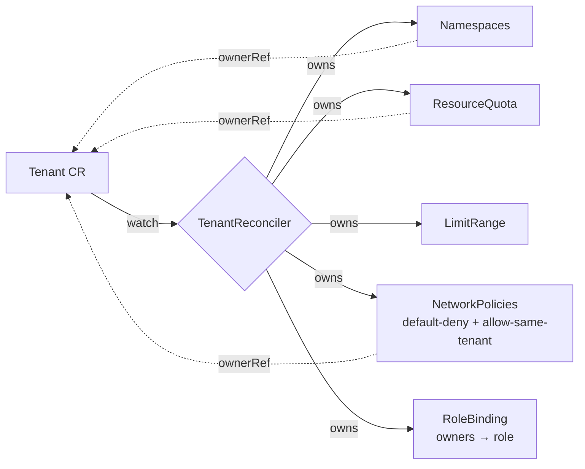

<div align="center">

# kubtenant

**Self-service, guardrailed multi-tenancy for Kubernetes — as a single CRD.**

[](https://github.com/HariBoddapati01/kubtenant/actions/workflows/ci.yaml)
[](https://goreportcard.com/report/github.com/HariBoddapati01/kubtenant)
[](https://pkg.go.dev/github.com/HariBoddapati01/kubtenant)
[](LICENSE)
[](go.mod)

</div>

---

`kubtenant` is a Kubernetes operator that turns *soft multi-tenancy* from a manual, error-prone checklist into a **single declarative resource**. A platform team hands application teams one API — the `Tenant` — and the operator reconciles it into a fully guardrailed set of namespaces: resource quotas, default limits, network isolation, and owner RBAC, all garbage-collected together.

It's the primitive most internal developer platforms end up building by hand. This one is small, dependency-light, and boring on purpose.

## Why

Standing up a new team's namespaces "properly" usually means remembering to apply five different objects, in the right order, with consistent labels, every single time:

| Manual toil | What gets forgotten |
| --- | --- |
| Create the namespace | Consistent labels for policy/selectors |
| Apply a `ResourceQuota` | A team ships an unbounded Job and drains the cluster |
| Apply a `LimitRange` | Pods with no requests wreck the scheduler's bin-packing |
| Apply `NetworkPolicies` | Namespaces stay flat and open by default |
| Bind the team's group to a role | Over-broad `cluster-admin` grants "just for now" |

`kubtenant` collapses all of that into one object and keeps it continuously reconciled — drift is repaired on the next loop.

## How it works



Every managed object carries an `ownerReference` back to the `Tenant`, so:

- **Deletion is free** — `kubectl delete tenant acme` garbage-collects every namespace and everything in it.
- **Drift self-heals** — the controller `Owns()` each resource type, so a manual edit to a managed quota triggers a re-reconcile.
- **Reconciliation is idempotent** — every object is created-or-updated; running the loop a thousand times converges to the same state.

See [`docs/architecture.md`](docs/architecture.md) for the full design, failure semantics, and multi-tenancy threat model.

## Quickstart

```bash
# 1. Install the CRD and deploy the controller
make deploy IMG=ghcr.io/hariboddapati01/kubtenant:latest

# 2. Create a tenant
kubectl apply -f config/samples/tenant.yaml

# 3. Watch it provision
kubectl get tenant acme -w
# NAME   PHASE    NAMESPACES                              AGE
# acme   Active   [acme-dev acme-staging acme-prod]       6s

kubectl get ns -l platform.hariboddapati.dev/tenant=acme
kubectl get resourcequota,limitrange,networkpolicy,rolebinding -n acme-prod
```

## The API

```yaml
apiVersion: platform.hariboddapati.dev/v1alpha1
kind: Tenant
metadata:
  name: acme
spec:
  displayName: "ACME Corp"
  namespaces: [acme-dev, acme-staging, acme-prod]
  owners:
    - { kind: Group, name: acme-platform-admins }
  ownerRole: admin              # ClusterRole bound namespace-scoped to owners
  resourceQuota:                # aggregate ceiling per namespace
    cpu: "16"
    memory: 32Gi
    pods: "80"
  limitRange:                   # default container requests/limits
    defaultCPU: 500m
    defaultMemory: 512Mi
    defaultRequestCPU: 100m
    defaultRequestMemory: 128Mi
  networkIsolation: true        # default-deny ingress + allow-same-tenant
```

Full field reference: `kubectl explain tenant.spec`.

## Local development

Requires Go 1.26+. No cluster is needed for the test suite — it runs entirely against the controller-runtime fake client.

```bash
make test          # generate + fmt + vet + unit tests (-race)
make lint          # golangci-lint
make run           # run the controller against your current kubeconfig
make docker-build  # distroless, non-root, static binary
```

Try it end-to-end on a throwaway cluster:

```bash
kind create cluster
make install deploy
kubectl apply -f config/samples/tenant.yaml
```

## Design choices worth calling out

- **Cluster-scoped `Tenant`.** Tenants provision namespaces, which are cluster-scoped, so the owning object must be too. This makes garbage collection native rather than finalizer-driven.
- **No finalizers.** All cleanup is expressed through owner references. Fewer moving parts, no stuck-terminating edge cases.
- **Thin, validated spec projection.** Rather than embedding raw `ResourceQuota`/`LimitRange` specs, the API exposes a small, opinionated surface (`cpu`, `memory`, `pods`, container defaults). Guardrails, not a passthrough.
- **`admin`, not `cluster-admin`.** Owners get the built-in `admin` ClusterRole *bound at namespace scope*, giving full control inside their namespaces and nothing outside them.

## Roadmap

- [x] Namespace pruning — reclaim namespaces dropped from `spec.namespaces`
- [x] Prometheus metrics for tenant/namespace counts and reconcile outcomes
- [ ] `envtest`-based integration suite in CI
- [ ] Optional `LimitRange` for PVCs and per-pod maxima
- [ ] Egress `NetworkPolicy` templates
- [ ] Namespace `PriorityClass` and `PodSecurity` admission labels
- [ ] Conversion webhook + `v1beta1` graduation

## License

Apache 2.0 — see [LICENSE](LICENSE). © 2026 Hari Boddapati.
